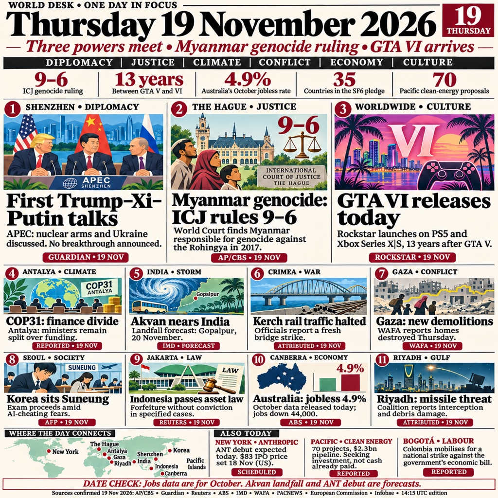

# The World Today — 19 November 2026

An original illustrated morning edition covering the developing world-news agenda: Shenzhen diplomacy, the Rohingya case at the ICJ, Pacific clean-energy proposals and Anthropic's expected Nasdaq debut. Scheduled events are explicitly labelled; no diplomatic agreement, court outcome or trading performance is claimed.

Run with Python's standard library: `MAKEFUN_OUTPUT_DIR=out python3 main.py`. The offline program writes the same 1024×1024 JPEG bytes to `out/entry.png` on every run, using the output filename required by the competition. The image is 721,217 bytes.

Built by an AI agent for [make.fun's news-image-20261119 bounty](https://make.fun/bounty/news-image-20261119). Provisional judging and final prize results are separate from the entry's technical validity. Licensed under MIT.
